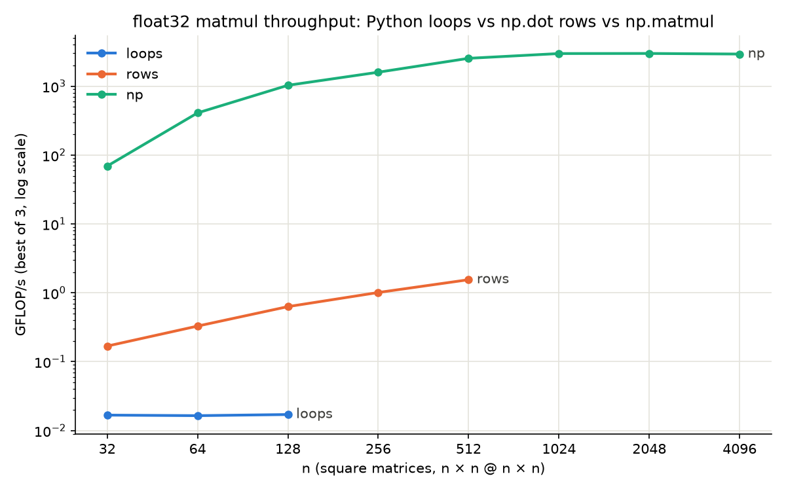
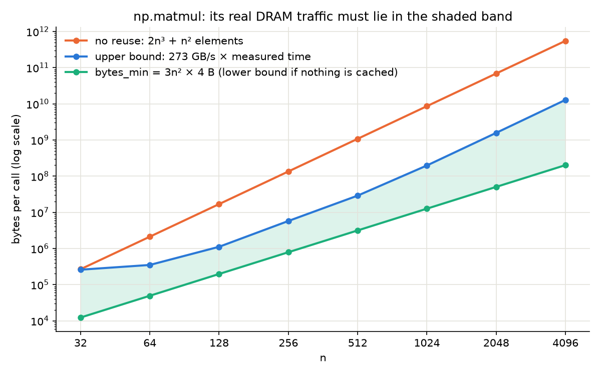
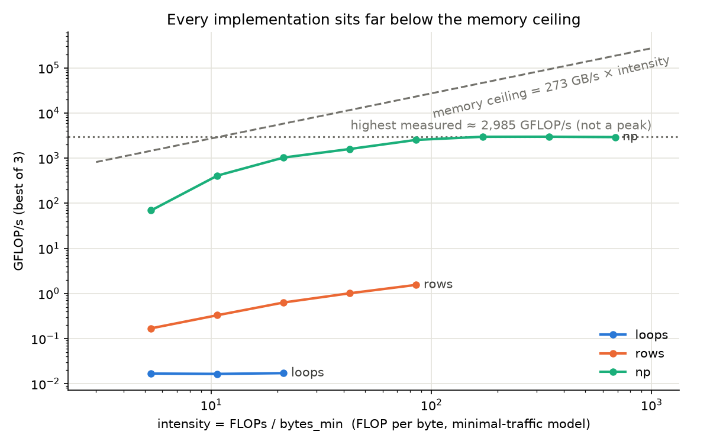

# Week 01: matmul three ways

Run of 2026-10-11 on an Apple M4 Pro (14 logical cores), NumPy 2.5.3 with Accelerate BLAS, float32, no thread
variables set (Accelerate picks its own thread count). Data: `benchmarks/week-01-matmul.csv` (best of 3),
`benchmarks/week-01-matmul-raw.csv` (every trial), `benchmarks/week-01-env.json`. Produced by `matmul_bench.py`;
the two extra charts come from `plot_results.py`, which reads the saved CSV.

Correctness: all three implementations agree under `allclose(rtol=1e-5, atol=1e-6)` on a 16×32×24 float32 case;
max |loops − np| = 1.9e-6, from summing in a different order.

## Results

| impl | n | best | GFLOP/s | FLOPs | bytes_min | intensity (FLOP/B) |
|---|---|---|---|---|---|---|
| loops | 32 | 3.91 ms | 0.017 | 65.5 K | 12.3 KB | 5.3 |
| loops | 64 | 31.8 ms | 0.016 | 524 K | 49.2 KB | 10.7 |
| loops | 128 | 245.2 ms | 0.017 | 4.19 M | 197 KB | 21.3 |
| rows | 32 | 389 µs | 0.169 | 65.5 K | 12.3 KB | 5.3 |
| rows | 64 | 1.59 ms | 0.329 | 524 K | 49.2 KB | 10.7 |
| rows | 128 | 6.65 ms | 0.630 | 4.19 M | 197 KB | 21.3 |
| rows | 256 | 33.2 ms | 1.011 | 33.6 M | 786 KB | 42.7 |
| rows | 512 | 173.2 ms | 1.550 | 268 M | 3.15 MB | 85.3 |
| np | 32 | 0.947 µs | 69 | 65.5 K | 12.3 KB | 5.3 |
| np | 64 | 1.28 µs | 409 | 524 K | 49.2 KB | 10.7 |
| np | 128 | 4.07 µs | 1,030 | 4.19 M | 197 KB | 21.3 |
| np | 256 | 21.0 µs | 1,595 | 33.6 M | 786 KB | 42.7 |
| np | 512 | 105.7 µs | 2,538 | 268 M | 3.15 MB | 85.3 |
| np | 1024 | 721 µs | 2,977 | 2.15 G | 12.6 MB | 170.7 |
| np | 2048 | 5.75 ms | 2,985 | 17.2 G | 50.3 MB | 341.3 |
| np | 4096 | 46.9 ms | 2,928 | 137 G | 201 MB | 682.7 |

What the chart shows:

- **loops is flat at ~0.017 GFLOP/s.** Every multiply-add pays the Python interpreter's cost (~120 ns each), and
  that cost does not shrink with n.
- **rows roughly doubles with each doubling of n**, then starts to bend at 512. Python pays a fixed ~0.4 µs per
  `np.dot` call, and each call does 2n FLOPs, so bigger n means more work per fixed cost.
- **np climbs from 69 to ~3,000 GFLOP/s and plateaus from n=1024.** At small n a ~1 µs per-call cost (dispatch,
  output allocation, BLAS setup) dominates: at n=32 the arithmetic alone would take ~22 ns at the plateau rate. At
  large n that cost is negligible and BLAS can use all cores and vector units.
- At n=128 the three are 245 ms, 6.65 ms and 4.07 µs for the same 4.19 M FLOPs: loops is ~60,000× slower than np,
  rows ~1,600×.

## 3. FLOPs and bytes: what `bytes_min` is, and why it is not measured DRAM traffic

`flops = 2·M·N·K` and `bytes_min = (M·K + K·N + M·N) · itemsize`: read every element of A once, read every element
of B once, write every element of C once. No correct matmul can touch less data than that, so it is a lower bound on
the data the computation needs. It is not a measurement of how many bytes cross the DRAM bus, for three reasons.

**1. The code asks for far more data than `bytes_min`.** Count the loads in the source. `matmul_loops` does
`A[i, k] * B[k, j]` for every (i, j, k), so it requests 2·n³ elements, and writes n² more. Each element of A is
requested n times (once per column j) and each element of B n times (once per row i). With no reuse at all, the
traffic would be (2n³ + n²)·4 bytes, which is 2n/3 times `bytes_min`: 85× at n=128, 2,700× at n=4096.

**2. Caches decide how many of those requests reach DRAM.** Between the cores and DRAM sit caches: small, fast
memories that keep recently used data. When a requested element is already in cache, the load is served there and
no DRAM traffic happens. Whether it is depends on two things:

- *Does the working set fit?* The working set here is A + B + C, which equals `bytes_min`. As a rough guide (from
  Apple's published core design, not measured here), each M4 Pro performance core has an L1 data cache on the order
  of 100 KB, and each core cluster shares an L2 on the order of 10 MB. So:

  | n | A + B + C | fits on-chip? |
  |---|---|---|
  | 128 | 197 KB | yes (L2, close to L1) |
  | 512 | 3.15 MB | yes (L2) |
  | 1024 | 12.6 MB | borderline |
  | 2048 | 50.3 MB | no |
  | 4096 | 201 MB | no, must stream from DRAM |

- *What order is data used in?* Memory moves in whole cache lines (64–128 bytes, many float32 values at once), not
  single elements. `A[i, :]` walks along a row, so one line feeds many consecutive loads. `B[:, j]` walks down a
  column, jumping n·4 bytes between elements, so each load touches a different line and only one value of it is
  used before moving on. The same source line can therefore be cache-friendly for A and cache-hostile for B.

**3. The benchmark itself favors the cache.** Every trial reuses the same arrays and runs after a warm-up. For
n ≤ 512 the whole working set likely stays on-chip between calls, so a warm call may move close to zero bytes from
DRAM. That is less than `bytes_min`. So `bytes_min` is a lower bound on DRAM traffic only for a cold run, where
nothing starts in cache.

### Bounding np.matmul's real DRAM traffic from the timing

The experiment doesn't measure DRAM traffic, but the measured time gives an upper bound. DRAM can deliver at most
273 GB/s, so a call that took `t` seconds moved at most 273 GB/s × `t` bytes from DRAM. For a cold call, real
traffic sits between `bytes_min` and that ceiling:

| n | bytes_min | max possible from 273 GB/s × time | no-reuse traffic | reuse needed (no-reuse ÷ max) |
|---|---|---|---|---|
| 128 | 0.20 MB | 1.11 MB | 16.8 MB | ≥ 15× |
| 512 | 3.15 MB | 28.9 MB | 1.07 GB | ≥ 37× |
| 1024 | 12.6 MB | 197 MB | 8.59 GB | ≥ 44× |
| 2048 | 50.3 MB | 1.57 GB | 68.7 GB | ≥ 44× |
| 4096 | 201 MB | 12.8 GB | 550 GB | ≥ 43× |

The orange line (no reuse) is far above the blue line (the most DRAM could deliver in the measured time). At
n=4096, fetching every requested element from DRAM would mean moving 550 GB, which takes at least 2 s at 273 GB/s,
yet the call finished in 47 ms. **So `np.matmul` must reuse each element it loads at least ~43 times on average
before it leaves the cache.**

It does this with blocking (tiling): instead of streaming a whole row and column per output, BLAS loads a small
square tile of A and a tile of B into cache, and does all the multiply-adds between them before loading the next
pair. A tile of side `b` uses each loaded element about `b` times, cutting A and B traffic to roughly 2n³·4/b bytes.
Fitting under the 12.8 GB ceiling at n=4096 needs b ≳ 43. Real BLAS kernels use several levels of tiling (registers,
L1, L2), so actual reuse is likely much higher. This experiment shows only the lower bound.

The same bounds give the real intensity: at n=4096 it lies between 137 G ÷ 12.8 GB ≈ **11 FLOP/B** (if DRAM ran
flat out the whole time) and **683 FLOP/B** (`bytes_min`). The intensity column in the table is the optimistic end.

For loops and rows the upper bound is useless: their times are so long that 273 GB/s × time is far more than the
no-reuse traffic. They are limited by Python overhead, not by memory, so how many bytes they move doesn't matter.

### How DRAM traffic could actually be measured

Directly, with hardware performance counters that count memory-controller or cache-miss events, for example Xcode
Instruments' CPU Counters on macOS, or `perf` with memory events on Linux. A cold-cache variant of the benchmark
(touching a large unrelated buffer between calls to flush the caches) would also show how much the warm runs here
benefit from cache. Neither was done here.

## 4. Timing: best vs median at n=128

Per-call times from the three recorded trials. Each trial is a block of `repeats` calls divided by the repeat count.

| impl | repeats | min | median | observed range |
|---|---|---|---|---|
| loops | 1 | 245.24 ms | 245.28 ms | 245.24–250.46 ms |
| rows | 8 | 6.654 ms | 6.658 ms | 6.654–6.704 ms |
| np | 10000 | 4.073 µs | 4.098 µs | 4.073–4.129 µs |

Best-time and median-time rankings agree: np < rows < loops. The best-to-median gap is under 1% for all three, so
at n=128 the choice of summary doesn't change any conclusion.

Even though the ranks agree, this is not a latency guarantee. There are only three samples per implementation. For
rows and np each sample is an average over a block of 8 or 10,000 calls, so no individual call was ever timed and any
slow single call is hidden inside the average. All runs use warm caches and the same arrays, so this is favorable
warm throughput, not typical request latency. A useful follow-up: rerun with the implementation order alternated
(inputs, thread settings and warm-up held fixed). In this run every np case ran last, and np at n=4096 had one slow
trial (51.3 ms against 46.9 and 47.1 ms) that could be order or heat related.

## 5. Hardware context and peak

This roofline-style view plots each run at its minimal-traffic intensity. The dashed line is the memory ceiling,
273 GB/s × intensity: the fastest any code could go if it moved exactly `bytes_min` from DRAM. The dotted line is
the highest rate measured. Every point sits below the memory ceiling, and np stops rising at the dotted line well
before reaching it.

The CPU/Accelerate peak for float32 matmul on this machine is not established here. I don't have a published,
sourced CPU or Accelerate FP32 peak for the M4 Pro, and the GPU's compute figure does not apply to NumPy on the CPU.
So I can't state a percent-of-peak. What the evidence does support:

- **Highest measured rate:** about 2.9–3.0 TFLOP/s from n=1024 to 4096 (2,977, 2,985, 2,928 GFLOP/s). This is a
  lower bound on what this CPU and backend can do, not the peak.
- **Memory bandwidth is unlikely to be the limit at large n, but timing alone can't prove it.** The ~11 FLOP/B
  pessimistic intensity above is derived from the measured time, so it can't be used to rule bandwidth in or out: if
  np reused each element exactly ~43×, DRAM would be saturated. Two observations argue against that. First, blocked
  BLAS kernels normally reuse data far more than 43×, which would put the ceiling far above the measured rate (up to
  186 TFLOP/s at `bytes_min`). Second, and more directly, GFLOP/s is the same at n=1024 (working set ~12.6 MB, close
  to fitting on-chip) and n=4096 (201 MB, which must stream from DRAM). If DRAM bandwidth were the bottleneck,
  throughput should drop once the data stops fitting in cache, and it doesn't. The plateau is most likely set by the
  compute units, but confirming that needs the performance counters described above.
- **Small n is limited by overhead, not memory.** At n=32 the memory ceiling would be ≈ 273 × 5.3 ≈ 1,450 GFLOP/s,
  but np reached 69 GFLOP/s. Most of its ~0.95 µs per call is fixed call, dispatch and allocation cost.

## 6. Three sentences

At n=128 the triple loop is about 60,000× slower than `np.matmul` (245.2 ms vs 4.07 µs best time, with matching
inputs and dtype), likely because every multiply-add goes through the Python interpreter while `np.matmul` makes
one call into Accelerate. `np.matmul`'s GFLOP/s rises with n (69 at n=32, 1,030 at 128, 2,538 at 512) because the
work grows as n³ while the roughly fixed per-call cost does not, and larger problems also let BLAS use more cores
and fill the vector units; the trend flattens from n=1024 at about 3.0 TFLOP/s. For n=4096 (2,928 GFLOP/s) the
evidence supports only that it sits on that plateau and that DRAM bandwidth is unlikely to be what limits it (the rate
matches n=1024, whose data nearly fits on-chip); without a sourced
CPU/Accelerate FP32 peak, its distance from an attainable peak can't be stated.
